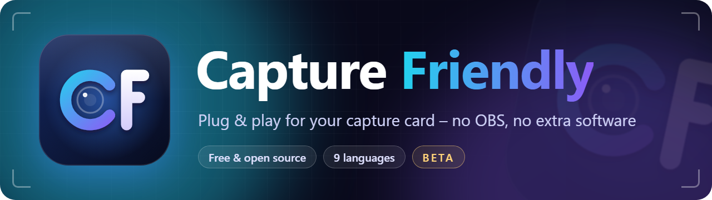

<p align="center">
  
</p>

<p align="center">
  <a href="https://github.com/S7VENZZ/capture-friendly/releases/latest"></a>
  
  
  <a href="https://github.com/S7VENZZ/capture-friendly/releases"></a>
  <a href="https://github.com/S7VENZZ/capture-friendly/stargazers"></a>
  <a href="LICENSE"></a>
  <a href="https://buymeacoffee.com/s7venz"></a>
</p>

<p align="center"><a href="README.md">English</a> · <b>Deutsch</b></p>

**Capture Friendly** zeigt Bild und Ton deiner Capture-Karte in einem eigenen Fenster. Das Fenster teilst du in Discord über **„Bildschirm teilen“**, der Ton kommt mit. Du brauchst dafür kein OBS.

**Plug & Play:** Karte anstecken, Programm starten, fertig. Die Karte wird von selbst erkannt und eingeschaltet.

> [!NOTE]
> **Beta.** Das Programm ist neu, es können noch Fehler auftreten. Wenn dir etwas auffällt, melde es bitte unter [Probleme melden](#probleme-melden).

## Schnellstart

1. Lade den Installer `Capture-Friendly-Setup-x.y.z.exe` von den [Releases](https://github.com/S7VENZZ/capture-friendly/releases/latest) und führe ihn aus.
   Windows warnt eventuell („Der Computer wurde durch Windows geschützt“), weil der Installer nicht signiert ist: **Weitere Informationen → Trotzdem ausführen**.
2. Stecke die Capture-Karte per USB an den PC. Die Konsole, das Handy oder der PC kommt per HDMI an den Eingang der Karte.
3. Starte **Capture Friendly**. Das Bild erscheint von selbst.
4. In Discord: **Bildschirm teilen** → „Capture Friendly“ wählen und den Ton des Fensters mitnehmen.

## Funktionen

| | |
|---|---|
| 🔌 **Automatische Erkennung** | Die Karte wird beim Start und beim Anstecken gefunden, ausgelesen und eingeschaltet. Webcams und virtuelle Kameras schaltet das Programm nie von selbst ein. |
| 🎞️ **Bildmodi auf einen Blick** | Die Einstellungen zeigen als Liste, was die Karte kann: 4K, 1440p, 1080p, 720p, 480p mit der jeweils höchsten Bildrate. Eine Karte wird nur beim ersten Mal ausgelesen und dann gemerkt. Steckst du eine andere an, wird sie neu ausgelesen. „Neu erkennen“ liest bei Bedarf erneut. |
| ⚡ **Mehr als 60 FPS** | Kann die Karte mehr (z. B. 120, 144 oder 240 FPS), erkennt das Programm es und bietet es zur Auswahl an, **aber nur bis zu dem, was die Karte bei der gewählten Größe kann** (z. B. 1440p bis 144, 4K bis 60). Wie viele Bilder wirklich ankommen, zeigt die Statistik (in den Einstellungen einschaltbar). |
| 🔊 **Sauberer Ton** | Nur der Ton der Karte (48 kHz), nie Mikrofon oder PC-Ton. Der Ton-Eingang unten ist von selbst die Karte, in Windows muss nichts eingeschaltet werden. Verstärkung von −12 bis +24 dB mit Begrenzer gegen Übersteuern. |
| 🛟 **Hilfe bei „Kein Ton“** | Kommt kein Ton an, sagt das Fenster, was du prüfen kannst (obere Leiste und Einstellungen → Ton → „Kein Ton?“). Es meldet auch, wenn Windows den Ton der Karte zusätzlich abspielt („Abhören“), sodass du alles doppelt hörst. |
| 🔈 **Ausgabe** | Der Ton läuft einmal, auf dem Windows-Standardgerät. Hörst du das Spiel schon am Fernseher, wählst du in den Einstellungen ein Gerät, das du nicht hörst. Discord bekommt den Ton trotzdem. |
| 🎨 **Immer ein sattes Bild** | Karten liefern das Bild oft „begrenzt“ (Schwarz ist dann grau). Capture Friendly korrigiert das immer, damit die Farben von einer Szene zur nächsten gleich bleiben. Dazu Helligkeit, Kontrast, Farbton, Sättigung und Spiegeln. |
| 🌍 **Neun Sprachen** | Englisch (Standard), Deutsch, Spanisch, Französisch, Portugiesisch (Brasilien), Russisch, Chinesisch (vereinfacht), Japanisch und Türkisch. Die Auswahl steht ganz oben in den Einstellungen und gilt sofort. |
| 📡 **Kein Signal & Auto-Reconnect** | Kommt kein Bild mehr an, zeigt das Fenster es klar an. Wird die Karte abgesteckt, schaltet sich das Programm wieder ein, sobald sie zurück ist. |
| 🙈 **Private-Modus** | Eine Taste (**B**): Bild sofort schwarz, Ton still. |
| 💬 **Anzeige in Discord (optional)** | In den Einstellungen unter „Discord“ einschaltbar, **standardmäßig aus**. Dann sehen deine Freunde „Capture Friendly“ mit Laufzeit und einem Knopf zum Laden, solange das Bild läuft, als würdest du ein Spiel spielen. Du musst nichts verknüpfen, Discord muss nur auf deinem PC laufen. |
| ⬆️ **Aktualisiert sich selbst** | Einstellungen → Info → **Prüfen**. Gibt es eine neue Version, klickst du auf **Aktualisieren**, und das Programm erledigt den Rest. |
| 🪟 **Immer 100 %** | Das Bild passt sich ganz ins Fenster ein, wie in OBS. Nichts wird gezoomt oder abgeschnitten. |

**Tasten:** `Leertaste` an/aus · `S` Einstellungen · `F` / `F11` / Doppelklick Vollbild · `B` Private-Modus · `I` Statistik (standardmäßig aus; Warnungen erscheinen immer) · `Esc` Einstellungen schließen

## Getestet mit

Getestet wurde Capture Friendly mit einer **UGREEN**-Capture-Card. Bei anderen Karten weiß ich nicht, ob sie funktionieren. Das Programm nutzt den Standard-Videotreiber von Windows (UVC): Karten, die sich als Kamera oder „USB Video“ melden, sollten ohne weitere Software laufen. Eine Garantie gibt es nicht.

Hat deine Karte einen Namen, den das Programm nicht erkennt, wählst du sie einmal unten links aus. Danach wird sie wiedererkannt.

## Kein Ton?

Meistens kommt der Ton gar nicht erst bei der Karte an. Das Programm sagt es selbst in der oberen Leiste, wenn nur Stille ankommt, und hat diese Liste in den Einstellungen (Ton → „Kein Ton?“). Geh sie der Reihe nach durch:

1. **Stell das HDMI-Audio der Konsole auf „Stereo unkomprimiert“ (PCM).** Xbox: Einstellungen → Allgemein → Lautstärke & Audioausgabe → Lautsprecher-Audio → HDMI-Audio. PlayStation: Einstellungen → Ton → Audioausgabe → Audioformat (Priorität) → Linear PCM. Formate wie Dolby, DTS oder Atmos kann die Karte nicht weitergeben, dann ist es still. Die Menünamen können leicht abweichen. Hängt ein Fernseher oder eine Soundbar am HDMI-Ausgang der Karte, übernimmt die Konsole so ein Format manchmal von dort: Zieh das HDMI-Kabel zum Fernseher einmal ab und probiere es noch einmal.
2. **Spiel etwas mit lautem Ton ab.** Menü-Klicks sind sehr leise. Ein Spiel oder Video zeigt sofort, ob Ton ankommt. Ein leises Rauschen in Stille ist das Eigenrauschen der Karte.
3. **So siehst du, ob Ton ankommt:** Windows → Einstellungen → System → Sound → Eingabe → die Karte wählen („HDMI …“). Der Balken unter „Mikrofon testen“ bewegt sich, wenn Ton von der Karte ankommt.
4. **Discord:** Nimm beim Teilen des Fensters den Ton mit (der Ton-Schalter im Teilen-Fenster). Sonst bekommen deine Freunde das Bild ohne Ton.
5. **Ausgabe:** Wähle in den Einstellungen des Programms (Ton → Ausgabe) nur dann ein Gerät, das du nicht hörst, wenn du das Spiel schon am Fernseher hörst. Ohne Auswahl spielt das Programm den Ton auf dem Windows-Standardgerät.
6. **Lass „Dieses Gerät als Wiedergabequelle verwenden“ ausgeschaltet** (Windows → Sound → Aufnahme → die Karte → Eigenschaften → Abhören). Das Programm spielt den Ton selbst. Mit diesem Schalter hörst du alles doppelt, dazu das Rauschen der Karte, auch wenn das Programm gar nicht läuft.
7. **Windows-Datenschutz:** Einstellungen → Datenschutz & Sicherheit → Mikrofon muss Desktop-Apps erlauben (für Windows ist der Ton-Eingang der Karte ein Mikrofon-Eingang; das Programm öffnet nur den Eingang, der zur Karte gehört). Steck die Karte an einen USB-3-Anschluss, nicht an einen Hub.

Immer noch nichts? Bitte [melde es](https://github.com/S7VENZZ/capture-friendly/issues/new/choose) mit dem Namen der Karte und der Konsole.

## Das Programm und deine Daten

- Keine Konten, keine Statistik-Übertragung, keine Übertragung von Bild oder Ton. Bild und Ton bleiben im Fenster, geteilt wird nur über Discord.
- Das Programm geht nur zu **GitHub**: um nach einer neuen Version zu fragen und, nach deinem Klick auf „Aktualisieren“, den Installer zu laden. Dessen Größe und Prüfsumme (SHA-256) werden vor dem Start mit den Angaben von GitHub verglichen.
- Nur wenn du die **Discord-Anzeige** einschaltest, spricht das Programm zusätzlich mit dem Discord-Programm auf deinem PC (lokal, nicht über das Internet). Es geht nur ein fester Text hin, nie Bild, Ton, Kartenname oder Gerät.
- Die Seite im Programm hat **keinen Netzwerkzugang** und keinen Zugriff auf deinen PC. Sie darf nur den Video- und Ton-Eingang deiner Karte benutzen, die Update-Anfrage stellen und fragen, ob Windows den Ton der Karte zusätzlich abspielt („Abhören“). Das ist ein Ja oder Nein: Das Programm liest diese Windows-Einstellung nur und ändert sie nie.
- Einstellungen werden nur lokal gespeichert.

## Hinweise

**Wie das Programm entstanden ist.** Capture Friendly wurde mit Hilfe einer **KI** (Claude von Anthropic) programmiert. Die **Idee, das Konzept, die Anforderungen (die Prompts), die Entscheidungen, das Testen an echter Hardware und die Veröffentlichung stammen von mir**, [S7VENZZ](https://github.com/S7VENZZ). Der Code selbst wurde von der KI geschrieben und getestet, kann aber trotzdem Fehler enthalten.

**Keine Gewähr, Nutzung auf eigene Gefahr.** Das Programm wird bereitgestellt, wie es ist („as is“), ohne Gewähr für Funktion, Eignung oder Fehlerfreiheit, und ist eine kostenlose Beta-Version. Ich hafte nicht für Schäden oder Folgen, die aus der Nutzung entstehen, soweit das gesetzlich zulässig ist. Das ist keine Rechtsberatung.

**Deine Verantwortung.** Übertrage nur Inhalte, die du zeigen darfst (Urheberrecht, Regeln von Spielen, Plattformen und Anbietern). Das Programm umgeht keinen Kopierschutz.

**Namen und Marken.** UGREEN, Discord, Windows, OBS und andere Namen gehören ihren Inhabern. Capture Friendly steht in keiner Verbindung zu ihnen und wird von ihnen weder unterstützt noch empfohlen.

### Lizenz

[MIT-Lizenz](LICENSE): Du darfst das Programm frei nutzen, ändern, weitergeben und auch kommerziell verwenden, wenn der Lizenz- und Copyright-Hinweis erhalten bleibt. Es gibt keine Gewähr.

Enthalten sind **Electron** (MIT) und **Chromium** (BSD-Lizenzen und weitere). Deren Lizenztexte liegen dem installierten Programm bei (`LICENSE.electron.txt` und `LICENSES.chromium.html`). Wie weit an KI-erzeugtem Code Urheberrechte bestehen, ist rechtlich noch nicht überall geklärt; die MIT-Lizenz gilt für alles, woran ich Rechte habe.

### Probleme melden

Fehler, Probleme und Wünsche bitte als **[Issue auf GitHub](https://github.com/S7VENZZ/capture-friendly/issues/new/choose)** melden (kostenlos mit GitHub-Konto). Das hilft:

- die **Version** (Einstellungen → Info) und deine **Windows-Version**
- wie die Karte unter **Erkannt** heißt
- was passiert ist und was du erwartet hast

Bitte schreibe keine privaten Daten in Texte oder Bilder. Das Programm ist ein Freizeitprojekt in der Beta: Eine Antwort oder Korrektur kann ich nicht versprechen.

### Unterstützen

Capture Friendly ist kostenlos und Open Source. Den Code hat zwar eine KI geschrieben, aber die Idee, die Arbeit drumherum und das Testen kommen von mir, damit du für Capture-Karten keinen Umweg über OBS brauchst. Wenn es dir hilft, freue ich mich über einen Kaffee, schon 1 € reicht:

<p align="center"><a href="https://buymeacoffee.com/s7venz"></a></p>

Spenden sind freiwillig und kein Kaufpreis: Es gibt dafür keine Gegenleistung, keinen Anspruch auf Support und keine Garantie.

## Selbst bauen

Voraussetzung: [Node.js](https://nodejs.org) (LTS).

```bash
npm install
npm start          # Programm starten
npm run dev        # mit Entwicklerwerkzeugen
npm test           # Unit-Tests
npm run dist       # Windows-Installer nach dist/
```

Eine neue Version veröffentlichst du mit `.\release.ps1 1.0.1`: Das Skript setzt die Version, führt die Tests aus, committet, setzt das Tag und pusht. Danach baut GitHub Actions den Installer und legt das Release an.

| Datei | Aufgabe |
|---|---|
| `main.js` | Fenster, Rechte, erlaubte Links |
| `preload.js`, `updater.js` | schmale Schnittstelle zwischen Fenster und Programm, das Aktualisieren (nur GitHub) |
| `presence.js` | die optionale Anzeige in Discord (nur über das lokale Discord) |
| `capture.html`, `capture.css`, `capture.js` | Oberfläche und Ablauf |
| `i18n.js` | die Wörter des Fensters in neun Sprachen (eine Sprache kommt als neuer Block dazu; `i18n.test.js` prüft, dass nichts fehlt) |
| `card-detect.js`, `card-match.js` | Karte unter den Videoeingängen finden, Audio-Eingang zur Karte finden |
| `about.js` | Name, Links, Discord-Anwendungs-ID und Versionsregeln (die einzige Stelle mit Adressen). Wer das Projekt forkt, trägt hier eine eigene Discord-Anwendungs-ID ein. Das Logo, das Discord zeigt, wird aus dem hier genannten Repository geladen; im Discord Developer Portal muss dafür nichts hochgeladen werden. |
