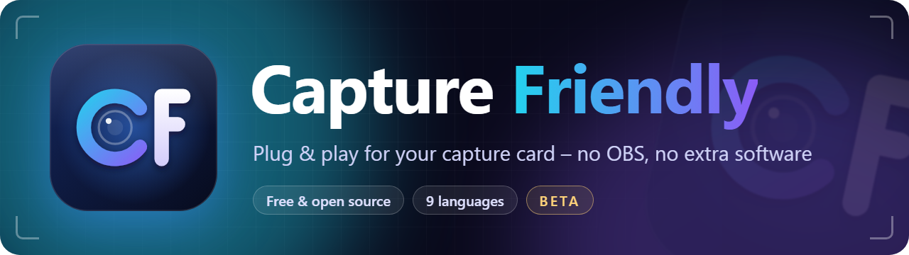

<p align="center">
  
</p>

<p align="center">
  <a href="https://github.com/S7VENZZ/capture-friendly/releases/latest"></a>
  
  
  <a href="https://github.com/S7VENZZ/capture-friendly/releases"></a>
  <a href="https://github.com/S7VENZZ/capture-friendly/stargazers"></a>
  <a href="LICENSE"></a>
  <a href="https://buymeacoffee.com/s7venz"></a>
</p>

<p align="center"><b>English</b> · <a href="README.de.md">Deutsch</a></p>

**Capture Friendly** shows the picture and sound of your capture card in a window of its own. You share that window in Discord with **“Share your screen”**, and the sound comes along. You do not need OBS for it.

**Plug & play:** plug in the card, start the program, done. The card is detected and switched on by itself.

> [!NOTE]
> **Beta.** The program is new, so errors can still occur. If you notice something, please report it under [Report a problem](#report-a-problem).

## Quick start

1. Download the installer `Capture-Friendly-Setup-x.y.z.exe` from the [Releases](https://github.com/S7VENZZ/capture-friendly/releases/latest) and run it.
   Windows may warn you (“Windows protected your PC”) because the installer is not signed: **More info → Run anyway**.
2. Plug the capture card into the PC with USB. The console, phone or PC goes into the HDMI input of the card.
3. Start **Capture Friendly**. The picture appears by itself.
4. In Discord: **Share your screen** → choose “Capture Friendly” and take the sound of the window along.

## Features

| | |
|---|---|
| 🔌 **Automatic detection** | The card is found, read and switched on when the program starts and when you plug it in. Webcams and virtual cameras are never switched on by themselves. |
| 🎞️ **Picture modes at a glance** | The settings list what the card can do: 4K, 1440p, 1080p, 720p, 480p, each with its highest frame rate. A card is read only the first time and then remembered. If you plug in another one, it is read afresh. “Detect again” reads again when needed. |
| ⚡ **More than 60 FPS** | If the card can do more (e.g. 120, 144 or 240 FPS), the program finds out and offers it, **but only up to what the card has at the chosen size** (e.g. 1440p up to 144, 4K up to 60). How many pictures really arrive is shown by the statistics (switch them on in the settings). |
| 🔊 **Clean sound** | Only the sound of the card (48 kHz), never the microphone or PC sound. The sound input at the bottom is the card by itself, so nothing has to be switched on in Windows. Gain from −12 to +24 dB with a limiter against distortion. |
| 🛟 **Help with no sound** | If no sound arrives, the window says what to check (top bar, and Settings → Sound → "No sound?"). It also tells you when Windows plays the sound of the card as well ("Listen to this device"), so you hear everything twice. |
| 🔈 **Output** | The sound plays once, on the Windows default device. If you already hear the game on the TV, choose a device you do not listen to in the settings. Discord still gets the sound. |
| 🎨 **Always a rich picture** | Cards often deliver the picture “limited” (black is then grey). Capture Friendly always corrects that, so the colours stay the same from one scene to the next. Plus brightness, contrast, hue, saturation and mirroring. |
| 🌍 **Nine languages** | English (default), German, Spanish, French, Portuguese (Brazil), Russian, Chinese (Simplified), Japanese and Turkish. The choice is at the very top of the settings and applies at once. |
| 📡 **No signal & auto-reconnect** | If no picture arrives any more, the window says so clearly. If the card is unplugged, the program switches itself on again as soon as it is back. |
| 🙈 **Private mode** | One key (**B**): picture black and sound silent at once. |
| 💬 **Show in Discord (optional)** | Can be switched on in the settings under “Discord”, **off by default**. Your friends then see “Capture Friendly” with a timer and a button to get it, while the picture runs, as if you were playing a game. You do not have to link anything; Discord only has to run on your PC. |
| ⬆️ **Updates itself** | Settings → Info → **Check**. If there is a new version, click **Update** and the program does the rest. |
| 🪟 **Always 100 %** | The picture always fits the window completely, like in OBS. Nothing is zoomed or cut off. |

**Keys:** `Space` on/off · `S` settings · `F` / `F11` / double click fullscreen · `B` private mode · `I` statistics (off by default; warnings always appear) · `Esc` close settings

## Tested with

Capture Friendly was tested with a **UGREEN** capture card. I do not know whether other cards work. The program uses the standard video driver of Windows (UVC): cards that report themselves as a camera or “USB Video” should run without extra software. There is no guarantee.

If your card has a name the program does not recognise, choose it once at the bottom left. After that it is recognised again.

## No sound?

Most of the time the sound does not reach the card in the first place. The program says so itself in its top bar when only silence arrives, and keeps this list in the settings (Sound → "No sound?"). Go through it in order:

1. **Set the HDMI audio of the console to "Stereo uncompressed" (PCM).** Xbox: Settings → General → Volume & audio output → speaker audio → HDMI audio. PlayStation: Settings → Sound → Audio Output → Audio Format (Priority) → Linear PCM. Formats like Dolby, DTS or Atmos cannot be passed on by the card, you get silence. The menu names can differ a bit. If a TV or soundbar is connected to the HDMI output of the card, the console may pick such a format from it: pull the HDMI cable to the TV once and try again.
2. **Play something with loud sound.** Menu clicks are very quiet. A game or a video shows at once whether sound arrives. A soft hiss in silence is the noise of the card itself.
3. **See whether sound arrives:** Windows → Settings → System → Sound → Input → choose the card ("HDMI …"). The bar under "Test your microphone" moves when sound comes in from the card.
4. **Discord:** when you share the window, take its sound along (the sound switch in the share dialog). Otherwise your friends get the picture without sound.
5. **Output:** in the settings of the program (Sound → Output), only choose a device you do not listen to if you already hear the game on the TV. Without a choice the program plays the sound on the Windows default device.
6. **Leave "Listen to this device" switched off** (Windows → Sound → Recording → the card → Properties → Listen). The program plays the sound itself. With this switch on you hear everything twice, plus the hiss of the card, even when the program is closed.
7. **Windows privacy:** Settings → Privacy & security → Microphone must allow desktop apps (for Windows the sound input of the card is a microphone input; the program only ever opens the input that belongs to the card). Plug the card into a USB 3 port, not into a hub.

Still nothing? Please [report it](https://github.com/S7VENZZ/capture-friendly/issues/new/choose) with the name of the card and the console.

## The program and your data

- No accounts, no statistics sent, no picture or sound sent anywhere. Picture and sound stay in the window; they are only shared through Discord.
- The program only talks to **GitHub**: to ask for a new version and, after you click “Update”, to download the installer. The size and checksum (SHA-256) of the installer are compared with what GitHub says before it is started.
- Only if you switch on the **Discord display** does the program also talk to the Discord program on your PC (locally, not over the internet). Only a fixed text goes there, never picture, sound, card name or device.
- The page inside the program has **no network access** and no access to your PC. It may only use the video and sound input of your card, make the update request, and ask whether Windows plays the sound of the card as well ("Listen to this device"). That is a yes or no: the program only reads this Windows setting and never changes it.
- Settings are only stored locally.

## Notes

**How the program came to be.** Capture Friendly was programmed with the help of an **AI** (Claude by Anthropic). The **idea, the concept, the requirements (the prompts), the decisions, the testing on real hardware and the publishing come from me**, [S7VENZZ](https://github.com/S7VENZZ). The code itself was written and tested by the AI, but it can still contain errors.

**No warranty, use at your own risk.** The program is provided as it is (“as is”), without any warranty of function, fitness or freedom from errors, and is a free beta version. I am not liable for damage or consequences that arise from its use, as far as the law allows. This is not legal advice.

**Your responsibility.** Only transmit content you are allowed to show (copyright, rules of games, platforms and providers). The program does not circumvent any copy protection.

**Names and trademarks.** UGREEN, Discord, Windows, OBS and other names belong to their owners. Capture Friendly has no connection to them and is neither supported nor endorsed by them.

### License

[MIT License](LICENSE): you may use, change and share the program freely, also commercially, as long as the license and copyright notice are kept. There is no warranty.

It includes **Electron** (MIT) and **Chromium** (BSD licenses and others). Their license texts come with the installed program (`LICENSE.electron.txt` and `LICENSES.chromium.html`). How far copyright exists in AI-generated code is not yet settled everywhere in law; the MIT license applies to everything in which I hold rights.

### Report a problem

Please report errors, problems and wishes as an **[issue on GitHub](https://github.com/S7VENZZ/capture-friendly/issues/new/choose)** (free with a GitHub account). This helps:

- the **version** (Settings → Info) and your **Windows version**
- what the card is called under **Detected**
- what happened and what you expected

Please do not put private data into texts or pictures. The program is a leisure project in beta: I cannot promise an answer or a fix.

### Support

Capture Friendly is free and open source. An AI wrote the code, but the idea, the work around it and the testing come from me, so that you do not need a detour through OBS for capture cards. If it helps you, I would be happy about a coffee, even 1 € is enough:

<p align="center"><a href="https://buymeacoffee.com/s7venz"></a></p>

Donations are voluntary and no purchase price: there is nothing in return, no claim to support and no guarantee.

## Build it yourself

Requirement: [Node.js](https://nodejs.org) (LTS).

```bash
npm install
npm start          # start the program
npm run dev        # with developer tools
npm test           # unit tests
npm run dist       # Windows installer into dist/
```

You publish a new version with `.\release.ps1 1.0.1`: the script sets the version, runs the tests, commits, sets the tag and pushes. GitHub Actions then builds the installer and creates the release.

| File | Purpose |
|---|---|
| `main.js` | window, permissions, allowed links |
| `preload.js`, `updater.js` | narrow interface between window and program, the updating (GitHub only) |
| `presence.js` | the optional display in Discord (only through the local Discord) |
| `capture.html`, `capture.css`, `capture.js` | interface and flow |
| `i18n.js` | the words of the window in nine languages (add a language by adding a block; `i18n.test.js` checks that nothing is missing) |
| `card-detect.js`, `card-match.js` | find the card among the video inputs, find the audio input of the card |
| `about.js` | name, links, Discord application ID and version rules (the only place with addresses). If you fork the project, enter your own Discord application ID here. The logo Discord shows is loaded from the repository named here, so nothing has to be uploaded in the Discord Developer Portal. |
